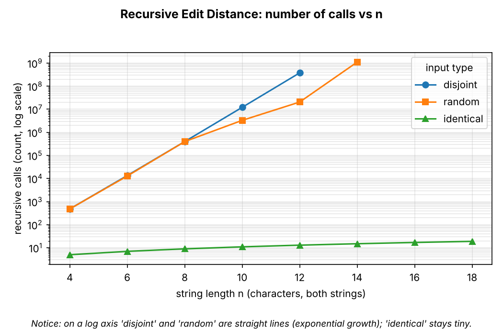
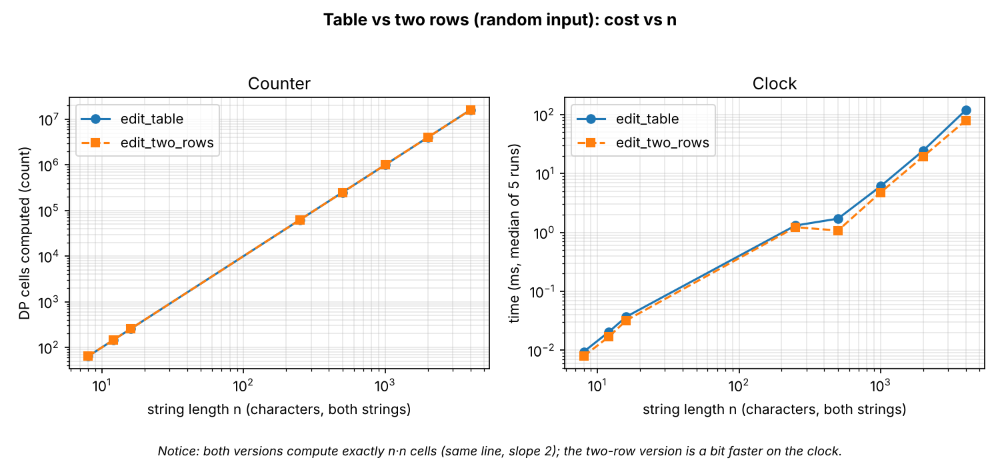
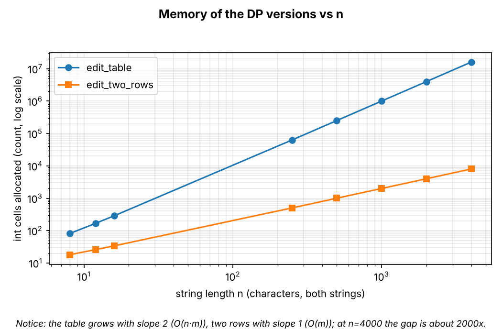
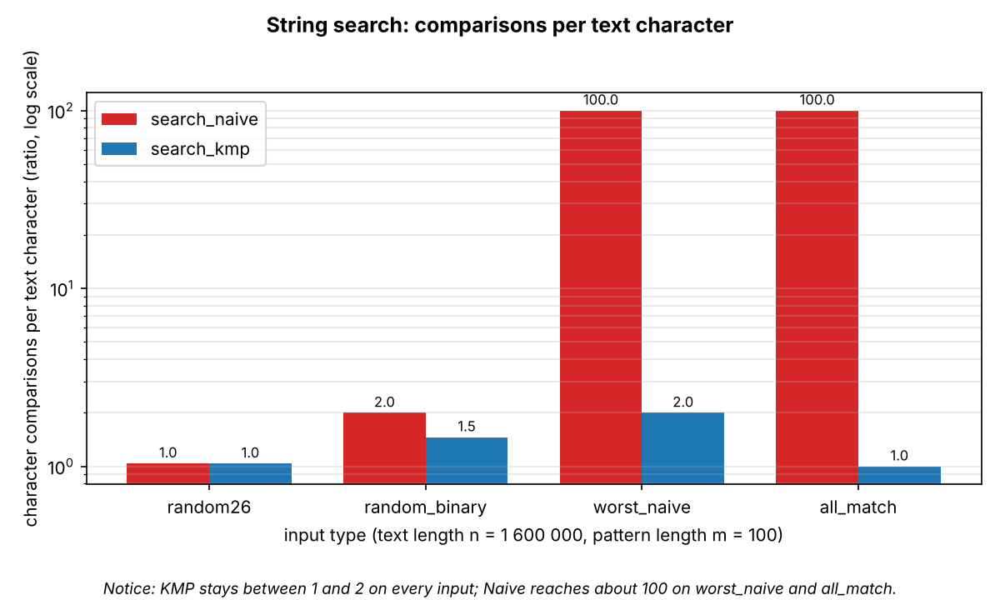
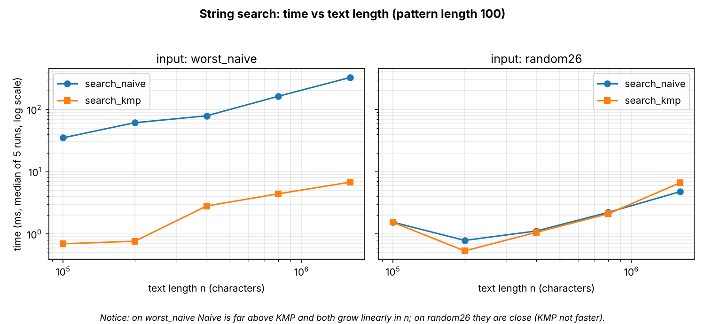

# Assignment 4 — City Search & Spell-Check: Report

## 1. Experiment Design Card (written before the first run)

| Field | Content |
|---|---|
| **Question** | **Edit Distance:** does the cost grow like theory says — exponential for plain recursion, O(n·m) for the table and the two-row version — and does the two-row version really save memory without losing speed? **String search:** does Naive really degrade to O(n·m) on a bad input while KMP stays O(n + m)? |
| **Sizes (n)** | *Edit Distance, recursive:* n = 4, 6, 8, 10, 12, 14, 16, 18 (both strings have length n). Stops automatically when one run takes more than 3 s, because the call count grows exponentially. *Edit Distance, table and two rows:* n = 8, 12, 16 (to compare with recursion on the same sizes) and n = 250, 500, 1000, 2000, 4000 (16x range; 4000x4000 = 16M cells is about 0.05–0.1 s, so the clock is not 0). *Search:* text length n = 100 000, 200 000, 400 000, 800 000, 1 600 000 (16x range), pattern length m = 100 fixed, so the growth in n is isolated. |
| **Inputs** | *Edit Distance:* **random** (26 letters; a typical typo-free case), **identical** (a = b, best case for recursion: every step matches, so only n+1 calls), **disjoint** (a = "aaa…", b = "bbb…"; no character ever matches, worst case for recursion: all three branches are used at every step). *Search:* **random26** (random text over 26 letters, pattern is a substring of the text; typical case), **random_binary** (alphabet {a, b}; many partial matches), **worst_naive** (text = a^n, pattern = a^99 b; Naive restarts almost completely at each position, no match at all), **all_match** (text = a^n, pattern = a^100; every position matches, output has n−m+1 entries). |
| **Metrics** | *Edit Distance:* `ops` = number of subproblems evaluated, counted inside the algorithm (recursive: calls; table/two rows: inner cells computed), because it is the cost unit the theory talks about and does not depend on the laptop. `mem_cells` = number of int cells allocated by the algorithm, to show O(n·m) vs O(m) memory. *Search:* `ops` = number of character comparisons (including the LPS build for KMP), `mem_cells` = LPS array size. For all: `time_ms` = median of 3–5 runs after a warm-up, as a second view. The result value (distance or number of matches) is saved too so that all algorithms are checked against each other on every row. |
| **Prediction** | *Recursive:* calls grow by a constant factor per step in n, about 5.8x per +1 on `disjoint` (Delannoy numbers) — a straight line on a log y-axis; `identical` stays linear (n+1 calls); `random` is in between but also exponential. The run time follows the call count. *Table / two rows:* `ops` = n·m exactly, for every input type (the DP does not look at the data); time should grow 4x when n doubles. The two-row version should have about the same time (maybe a bit faster thanks to cache), but its memory is (n+1)(m+1) / 2(m+1) ≈ n/2 times smaller — at n = 4000 about 2000x. *Naive:* about n comparisons on random26 (≈ 1 per position), slightly more on binary text (≈ 2 per position), and m·n ≈ 100n on `worst_naive`, so about 100x more than KMP. *KMP:* between n and 2n+2m comparisons on every input, i.e. the ratio comparisons / n stays flat around 1–2. On `all_match` both are expensive (Naive does m·n comparisons as well, because each match needs m checks; KMP about n). |
| **Plots** | P1: recursive `ops` vs n on a log y-axis for 3 inputs — *does recursion grow exponentially, and which input is the worst?* P2: `ops` and time of table vs two rows vs n (log–log) — *do both have the same O(n·m) growth, and is two-row slower or faster?* P3: memory cells of table vs two rows vs n (log y) — *how much memory does the two-row version save?* P4: comparisons / n for Naive and KMP per input type (ratio) — *which input is the worst for Naive, and does KMP stay flat?* P5: search time vs n (log–log) on worst_naive and random26 — *does the counter agree with the clock?* |

*Edits to the card after the first runs are listed in section 4.*

## 2. Plots and Results

All numbers come from `results/results.csv` (seed 42, 108 rows). Plots are made by `scripts/plots.py`.

**Takeaway:** on a log axis `disjoint` and `random` are close to straight lines, i.e. the number of calls grows exponentially, while `identical` needs only n+1 calls.

**Takeaway:** both DP versions compute exactly n·n cells (the two lines in the left plot lie on top of each other, slope 2); on the clock the two-row version is faster (about 80 ms vs 120 ms at n = 4000).

**Takeaway:** the table needs 16 008 001 cells at n = 4000, two rows only 8 002 — about 2000 times less, with slope 1 instead of slope 2.

**Takeaway:** KMP stays between 1.0 and 2.0 comparisons per text character on every input, Naive reaches 100 (= m) on `worst_naive` and `all_match`.

**Takeaway:** on `worst_naive` Naive is about 48x slower than KMP at n = 1.6M (326 ms vs 6.8 ms), but on `random26` KMP is not faster (6.6 ms vs 4.8 ms).

Key numbers (n = 1 600 000, m = 100):

| input | Naive comparisons | KMP comparisons | Naive ms | KMP ms |
|---|---|---|---|---|
| random26 | 1 664 008 | 1 661 670 | 4.8 | 6.6 |
| random_binary | 3 199 664 | 2 335 414 | 18.7 | 19.0 |
| worst_naive | 159 990 100 | 3 200 098 | 326.2 | 6.8 |
| all_match | 159 990 100 | 1 600 099 | 436.5 | 50.3 |

## 3. Prediction vs Result

**Edit Distance, recursive.** *Expected:* exponential growth, about 5.8x per +1 in n on `disjoint`, linear on `identical`. *Saw:* `disjoint` grew 30.5x from n=8 to 10 and 31.1x from n=10 to 12, i.e. about 5.6x per step — close to the prediction (the small gap comes from the match shortcut at the boundary rows). `identical` needed exactly n+1 calls (5 calls at n=4, 19 calls at n=18), so linear as predicted. `random` is **bumpy**: 3.3M calls at n=10, 20.6M at n=12 (6.2x in two steps) but 1.10G at n=14 (53.6x in two steps). *Why:* every n uses a *new* random pair, and the number of calls depends strongly on how many characters happen to match. So the trend is exponential, but single points are not smooth — a thing I did not predict.

**Edit Distance, table and two rows.** *Expected:* ops = n·m for every input, time x4 per doubling, same speed, memory ratio about n/2. *Saw:* ops = n·n exactly on all three inputs (the DP never looks at the data). Time per doubling from n=1000 on: two rows 4.1x and 4.1x, table 4.0x and 4.9x (the table is 64 MB at n=4000, so cache and memory traffic start to matter). The two-row version was 1.5x *faster* at n=4000 (79.9 vs 119.8 ms), more than the "a bit faster" I predicted; the explanation (less memory to touch) is my interpretation and I did not measure cache misses. Memory ratio at n=4000: 16 008 001 / 8 002 = 2000x, as predicted. One surprise on the clock: n=250 took 1.3 ms and n=500 only 1.7 ms (expected 4x). The counter shows exactly 4x, so the clock is disturbed by JIT warm-up at small n — a good example of why the counter is the main evidence.

**String search.** *Expected:* Naive ≈ 1 comparison per character on random26, ≈ 2 on binary, ≈ m on `worst_naive`; KMP between 1 and 2. *Saw:* Naive 1.04 / 2.00 / 100.0 comparisons per character, KMP 1.04 / 1.46 / 2.00 — as predicted. On `all_match` Naive makes 100 per character as predicted, KMP 1.0. *Surprise:* on `random26` and `random_binary` KMP is **not faster** on the clock, although it makes the same or fewer comparisons (6.6 vs 4.8 ms and 19.0 vs 18.7 ms). *Why (hypothesis):* with a 26-letter alphabet Naive almost always fails at the first character, so its inner loop is very cheap, while KMP pays for the LPS build and a more complicated loop for each character. I did not profile this. Also `all_match` is slower than `worst_naive` for Naive (436 vs 326 ms) with exactly the same number of comparisons: that case stores 1.6M results in a `List<Integer>` (boxing, memory allocation), so output size also costs time.

## 4. Changes to the Card

1. **Recursive stop rule:** the card said "stop when one run takes more than 3 s". My first run followed this rule and was killed after more than 5 minutes: `random` at n=14 took 3.0 s (1.1G calls), under my limit, so the next size n=16 started and would have needed about 90 s *per run*. I changed the rule to "stop after the first size that takes more than 300 ms", because one step of +2 in n costs 30–50x more. Consequence: `random` stops at n=14, `disjoint` at n=12; `identical` goes up to n=18.
2. Everything else (sizes, inputs, metrics, plots) is unchanged. The predictions above were written before the first run and were not edited.

## 5. Short Answers

**Which input made your string search slowest, and why?** `all_match` for Naive (436 ms at n = 1.6M); by comparison count it is tied with `worst_naive` (both 159 990 100 = about 100 per text character). In both inputs the pattern matches 99 or 100 characters at every start position before it ends (by a mismatch in the last character, or by a full match), and Naive then forgets everything and starts again one position later, so it needs about m·n comparisons. KMP uses its LPS array to keep what it already knows and never moves back in the text, so it needed only 1.0–2.0 comparisons per character. `all_match` is slower than `worst_naive` in time because it also builds an output list with 1.6M entries.

**How large an n could the recursive Edit Distance handle, and what stopped it?** On `random` up to n = 14 (3.0 s, 1.1 billion calls) and on `disjoint` only up to n = 12 (1.0 s, 377 million calls); on `identical` n = 18 was trivial (19 calls) but this input is not typical. What stopped it was **time**, through my 300 ms rule: the calls grow by about 5.6x per extra character, so n = 14 on `disjoint` would need about 30 s per run, and n = 4000 (which the table does in 0.1 s) is impossible. The call stack was not the limit (depth is at most 2n). The reason is repeated work: the same pair (i, j) is solved again and again, while the table solves each pair once (n·m = at most 16 million cells instead of billions of calls).

**What do you gain and what do you lose with two rows instead of the full table?** Gain: memory drops from (n+1)(m+1) to 2(m+1) cells — about 2000x at n = 4000 — and in my run it was also 1.5x faster. Lose: the full table is needed to walk back and print *which* edits were made (the alignment), and to reuse the answers for other prefixes; two rows give only the final number. For a spell-checker that only ranks candidates by distance this loss does not matter; for showing "what to change" it does.

**Which string search would I choose for the city platform and why?** KMP. In my data, for short street names and random-like text Naive is as fast or faster (4.8 vs 6.6 ms), so on average the choice does not matter. But the operators search long, repetitive log files, and there Naive can be 48x slower (326 vs 6.8 ms) or worse with longer patterns, while KMP never exceeded 2 comparisons per character. I prefer a guaranteed O(n + m) over a method that is good only on friendly input; the extra cost (an LPS array of m cells and a little more code) is small.

## 6. A Paragraph on Time

Measured times ranged from 0.0002 ms (recursive, `identical`, n=4) to 3.0 s (recursive, `random`, n=14), and from 5 ms to 436 ms for search at n = 1.6M; each value is the median of 3–5 runs after one warm-up run, on one machine. They are not my only evidence because the clock depends on the laptop, on JIT compilation (the n=250 → 500 anomaly), on the garbage collector and on memory effects such as boxing the result list; the same program on another computer gives other milliseconds. The counters (calls, cells, comparisons) are the same on every run and every machine, they are counted inside the algorithms, and they explain the shape of the curves: for example, 1.0 vs 100 comparisons per character says why Naive is slow on `worst_naive`, while the clock alone would have also hidden the surprise that KMP is not faster on random text.
